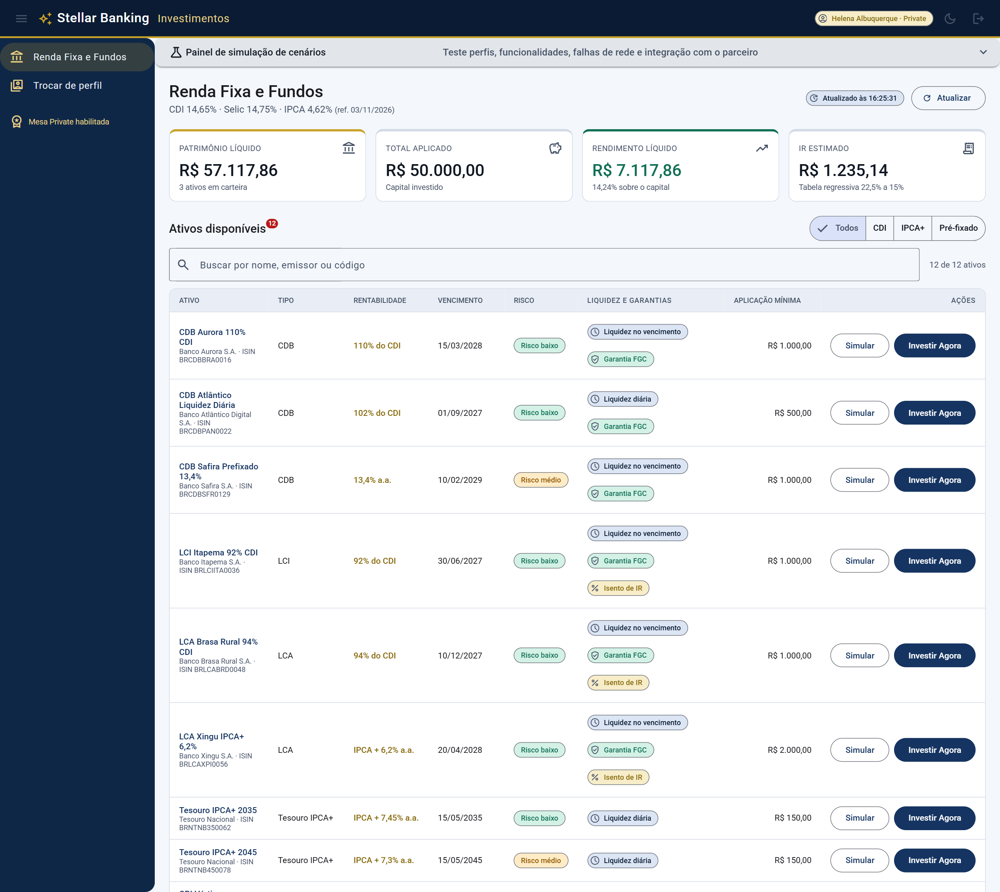
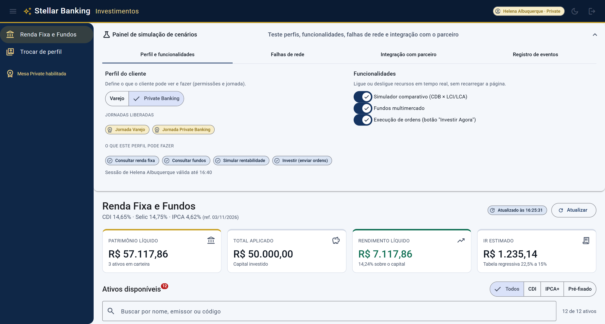
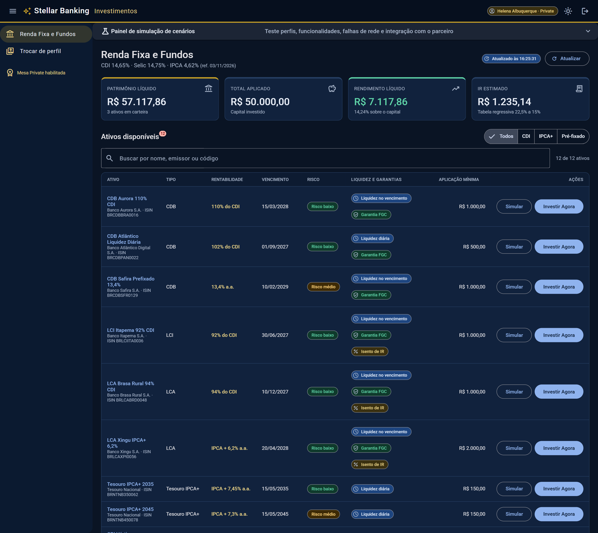

# Stellar Banking · Plataforma de Investimentos (Showroom Angular)

Projeto de referência para o **Mercado Financeiro (Renda Fixa e Fundos)**, construído com **Angular 22**
(Signals, Control Flow, Standalone, SSR + Hydration), **Angular Material 3**, **Elf** (estado) e
arquitetura **modular estilo Nx** (libs mapeadas em `tsconfig.json` via `@invest/*`).
Funciona **100% offline**: um interceptor simula o backend (CDB, LCI, LCA, Tesouro IPCA+, CRI/CRA e Fundos Multimercado).

<p align="center">
  
  <br />
  <sub><b>Home</b> — resumo patrimonial, filtro por indexador e tabela rica de ativos (perfil Private Banking).</sub>
</p>

<table>
  <tr>
    <td width="50%" align="center">
      
      <br /><sub><b>Painel de simulação de cenários</b> — ACL, Feature Flags, falhas HTTP e postMessage.</sub>
    </td>
    <td width="50%" align="center">
      
      <br /><sub><b>Tema escuro</b> — Design Tokens CSS + Material 3.</sub>
    </td>
  </tr>
</table>

## Como executar

Pré-requisitos: Node.js ≥ 22 (testado com 26) e npm.

```bash
npm install
npm run start:ssr        # build de produção + servidor SSR em http://localhost:4000
```

Outras opções:

| Comando                | Descrição                                                              |
| ---------------------- | ---------------------------------------------------------------------- |
| `npm start`            | Dev server (`ng serve`) em http://localhost:4200                       |
| `npm run build`        | Build de produção com SSR (`dist/shell-portal`)                        |
| `npm test -- --watch=false` | Testes unitários (Vitest via Angular CLI)                         |
| `npm run test:ci`      | Testes + cobertura com gate (limites em `angular.json`)                |
| `npm run lint`         | ESLint (TypeScript + templates + acessibilidade)                       |
| `npm run bundle:check` | Gate do bundle inicial (gzip) — rode após o build                      |
| `npm run audit:security` | `npm audit` das dependências de produção                             |

Variáveis do servidor SSR: `PORT` (padrão 4000), `ALLOWED_HOSTS` (hosts aceitos, separados por vírgula) e
`FRAME_ANCESTORS` (origens autorizadas a embarcar o portal em `<iframe>`).

## Estrutura

```
src/app                    shell-portal (App Host): layout, tema, sessão, painel de simulação, rotas, SSR
libs/mfe-renda-fixa        MFE (lazy): Container (smart) + AssetTable / YieldSimulator / PortfolioSummaryCards
                           / ComparativeSimulator (@defer) / InvestDialog (Stepper)
libs/http-core             Interceptors funcionais + backend simulado + feedback port
libs/auth-security         JWT, ACL, Journey Scopes, Feature Flags, guards, *hasPermission, HostBridge (postMessage)
libs/data-access-investments  Branded Types, regras de IR, Elf repository, API, Facade (Signals)
libs/ui-design-system      Design Tokens CSS, tema Material 3, KPI card, chips, skeleton, input monetário
```

Dependências permitidas (setas = "depende de"): `mfe → data-access → http-core → auth-security` e
`mfe/shell → ui-design-system`. Nunca no sentido inverso (ver [ADR-001](./ADR-001-ARCHITECTURE.md)).

## O que demonstrar (roteiro de 5 minutos)

Abra **http://localhost:4000** e use o **Painel de simulação de cenários** no topo:

1. **Perfil e funcionalidades** — alterne *Varejo × Private Banking*: o botão **Investir Agora** entra/sai do DOM
   (`*hasPermission`), a lista passa a exibir **Fundos Multimercado** e o painel mostra as jornadas e permissões
   do perfil em linguagem natural. Desligue funcionalidades (feature flags) e veja o comparativo / botão de ordens sumirem.
2. **Falhas de rede → falha temporária** — o `retryInterceptor` tenta de novo com *Exponential Backoff + Jitter*,
   com Snackbar a cada tentativa e registro detalhado. **Falha persistente** esgota as tentativas e mostra o erro.
3. **Expirar sessão (401)** — o `globalLogoutInterceptor` encerra a sessão, limpa Elf/cache/storage e abre o modal.
4. **Acessar fundos (exige Private Banking)** — o `authInterceptor` bloqueia *antes do envio* quando a jornada não está liberada.
5. **Integração com parceiro** — *Testar conexão / Selecionar o 1º ativo / Alternar tema* chegam ao MFE via
   `postMessage`; **Simular site malicioso** é bloqueado pela whitelist (veja as mensagens trocadas).
6. Role até o **Comparativo CDB × LCI/LCA**: o chunk é carregado via `@defer (on viewport; prefetch on idle)`.
7. Em **Private**, clique em **Investir Agora** (Stepper) e veja a carteira mudar (mutação no Elf); o backend
   simulado guarda a ordem, então ela permanece após **Atualizar**.

## Padrão de apresentação (UX)

Códigos internos (`FIXED_INCOME_READ`, `PRIVATE_BANKING`, `HOST_PING`, ISO/enum de liquidez etc.) **nunca** vão
para a tela: são traduzidos por mapas tipados (`Record<União, string>`) — `auth.labels.ts`, `models.ts`,
`describeEndpoint`. Ao criar uma permissão, jornada, família de ativo ou evento novo, o compilador exige o rótulo.

## Segurança (resumo)

- **JWT**: decodificado apenas para UX; a autorização real é sempre reavaliada no backend (o mock também o faz).
- **CSP** em `src/index.html` (documentada linha a linha) + `frame-ancestors`/`nosniff` no `server.ts`.
- **postMessage**: whitelist estrita de `event.origin`, checagem de `event.source`, validação de schema,
  `targetOrigin` explícito (nunca `*`) e comandos mínimos (o host não consegue alterar perfil).
- O token só é enviado a URLs **relativas da própria API** (nunca a terceiros).

## Observações

- Dados, emissores, CNPJs e taxas são **fictícios** e ilustrativos; não constituem oferta de investimento.
- O mock está em `libs/http-core/src/lib/mock-*.ts`; para um backend real, remova-o com
  `provideHttpCore({ useMockApi: false })`.
- Documentação adicional: [ADR-001-ARCHITECTURE.md](./ADR-001-ARCHITECTURE.md), [CLAUDE.md](./CLAUDE.md) e
  [AI_GUIDELINES.md](./AI_GUIDELINES.md).
